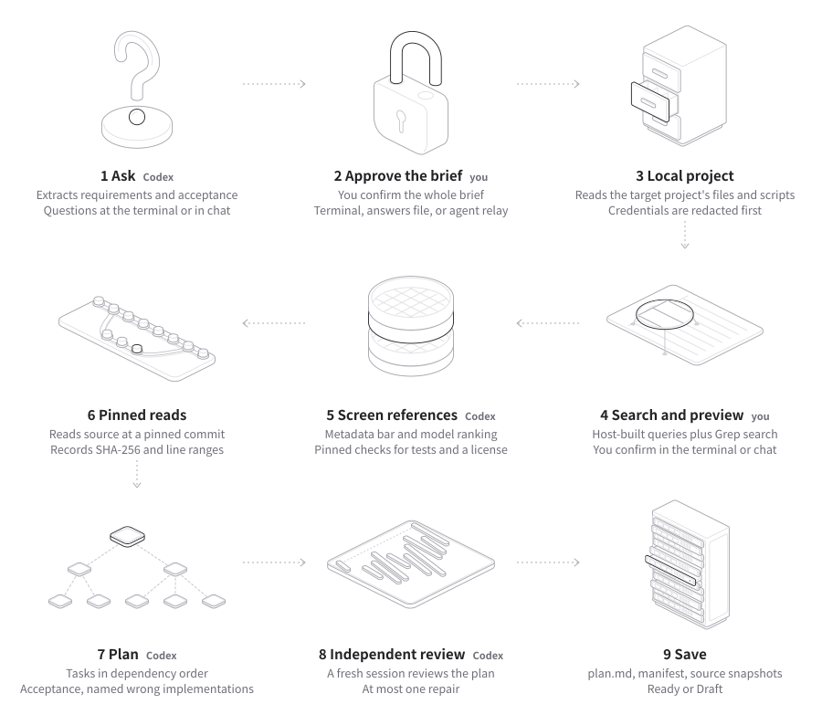

# Implementation structure and references

English · [简体中文](architecture.zh-CN.md)

<picture>
  <source media="(prefers-color-scheme: dark)" srcset="images/how-it-works-en-dark.svg">
  
</picture>

## Steps and modules

See [How it works](usage.md#how-it-works) in the README for what each step does. The table below lists the modules that carry out each step. Every Codex turn goes through [app-server.ts](../src/app-server.ts).

| Step | Contents | Main modules |
| --- | --- | --- |
| 1 Ask | Intake turn, material questions, brief rebuild after answers | [workflow.ts](../src/workflow.ts), [model-schema.ts](../src/model-schema.ts), [cli.ts](../src/cli.ts) |
| 2 Approve the brief | `yes` typed at the terminal, or `approveBrief: true` in the answers file; the host records the SHA-256 of the brief | [brief-approval.ts](../src/brief-approval.ts), [cli.ts](../src/cli.ts), [storage.ts](../src/storage.ts) |
| 3 Local project | Bounded file list, exclusion rules, credential redaction, existing scripts | [local.ts](../src/local.ts) |
| 4 Search | Tiered GitHub queries, Grep discovery, batched metadata query, GitLab fallback | [github.ts](../src/github.ts), [code-search.ts](../src/code-search.ts), [repository-screening.ts](../src/repository-screening.ts) |
| 5 Screen references | Metadata bar, model ranking turn, tree check at the pinned commit, model selection turn | [repository-screening.ts](../src/repository-screening.ts), [github.ts](../src/github.ts), [workflow.ts](../src/workflow.ts) |
| 6 Pinned reads | File selection turn, bounded reads, hashes, line ranges, excerpts, evidence request turn | [file-ranking.ts](../src/file-ranking.ts), [evidence.ts](../src/evidence.ts), [workflow.ts](../src/workflow.ts) |
| 7 Plan | Plan turn; the host checks IDs, citations, coverage, dependencies and named wrong implementations | [workflow.ts](../src/workflow.ts), [model-schema.ts](../src/model-schema.ts) |
| 8 Independent review | Review in a fresh session, one bounded repair, another review, the Ready or Draft decision | [workflow.ts](../src/workflow.ts), [model-schema.ts](../src/model-schema.ts) |
| 9 Save | Atomic writes of `plan.md`, both manifests, source snapshots and the answers file | [report.ts](../src/report.ts), [storage.ts](../src/storage.ts) |

[images/how-it-works.mjs](images/how-it-works.mjs) generates the diagram from Hairline line drawings. See [Credits](usage.md#diagrams-and-credits) in the README for how to generate it.

## Data flow

```text
CLI / JSON caller
       |
       v
workflow: intake -> answers -> brief rebuild -> brief approval -> search -> tree screen -> selection -> evidence -> plan -> fresh review
    |                |          |                  |
    v                v          v                  v
Codex App Server   public APIs  snapshots        PlanDoc
auth / thread /    + local FS   + manifest          |
turn / interrupt                                  v
                                           Markdown / JSON
```

## Boundaries

| File | Responsibilities |
| --- | --- |
| [cli.ts](../src/cli.ts) | Arguments, terminal clarification and brief approval, reading an answers file that carries an approved brief, writing answers files for `needs_input` and for unapproved plans, ASCII progress, JSON/JSONL and exit codes |
| [skill-install.ts](../src/skill-install.ts) | Embeds the unshit agent skill (`src/resources/unshit-skill/SKILL.md`) and writes it to the Claude Code skills directory and the two Codex skills directories (`$CODEX_HOME/skills`, `~/.agents/skills`); writes a temporary file first, then renames it; does not overwrite a skill of the same name that unshit did not install (unless `--force`); does not follow the `unshit` folder or `SKILL.md` when it is a symlink, but follows symlinks at the skills directory itself or higher up as usual |
| [workflow.ts](../src/workflow.ts) | Requirement gate, brief rebuild after answers, brief approval gate, candidate pre-ranking, screening and selection, reads, plan generation, the reference test gap, independent review and the one bounded repair (including surviving mutants and open decisions), timeout results and checkpoints |
| [app-server.ts](../src/app-server.ts) | Native bidirectional RPC, active turn correlation, final text, cancellation, idle and total-duration timeouts, failure reasons and process cleanup |
| [github.ts](../src/github.ts) | Host-built GitHub queries, Grep code search, the quality bar, the tree check at the pinned commit and the fallback to the official GitLab API |
| [code-search.ts](../src/code-search.ts) | Grep request body, response parsing, grouping hits by repository, qualifiers for the batched GitHub metadata query |
| [local.ts](../src/local.ts) | Local file baseline, exclusion rules, credential value redaction and private key file exclusion, evidence for existing scripts |
| [repository-screening.ts](../src/repository-screening.ts) | Cleaning domain query material, query plan, candidate signal parsing, whole-word candidate ranking, metadata and tree quality judgments |
| [file-ranking.ts](../src/file-ranking.ts) | Requirement term weighting, quotas for test and implementation files, text path and root license path checks, license file selection |
| [evidence.ts](../src/evidence.ts) | Bounded reads, shared file ranking, source hashes, line ranges, source IDs and permalinks |
| [model-schema.ts](../src/model-schema.ts) | Per-turn JSON Schema; checks of structure, source attribution (including the role of reference test excerpts), full coverage, the named wrong implementations of each verification, acyclic dependencies and quotes of the user's words (`userWords`); re-validation of the approved brief in an answers file; reading the surviving mutants of a review (dropping unusable items) |
| [brief-approval.ts](../src/brief-approval.ts) | The editable form of the brief and its SHA-256, requirement origin labels, the brief shown before terminal approval, the reply check that accepts only `yes`, the gap for inferred requirements and the note for an unapproved brief |
| [report.ts](../src/report.ts) | Markdown output of the brief approval record, requirements with origin labels, design, comparisons (the reference test for each adopted pattern, or the reason it has none), tasks, acceptance criteria, verification (including the wrong implementations that must make it fail), surviving mutants from reviews, "Trusted, not checked" and the source registry table |
| [storage.ts](../src/storage.ts) | Atomic saving of the report, evidence snapshots and a verifiable answers request context; writes an unapproved brief to the answers file in editable form, with `approveBrief` false; both manifests record `briefApproval` |
| [instructions.ts](../src/instructions.ts) | Embedded skill entry, stage modules and host/model responsibility constraints; computes the hash of the whole rule pack |

## State ownership

Codex manages authentication and sessions. In memory, the CLI correlates RPC messages and the current turn; the application stores source bytes, hashes, valid line ranges, the plan and gaps. The application uses this data to check citations and to save the results it already has when a run is interrupted.

The answers file for `needs_input` stores the original questions and the hashes of the prompt, the directory and the rule version. This solves the problem of questions changing order or wording when a non-interactive run is repeated. After the rerun, the requirement gate still checks for unresolved material questions.

The host passes answered questions as `resolvedAnswers` to the candidate selection, planning, review and repair turns, and writes them into the final result, the report, the manifest and interruption checkpoints. The report labels the initial summary and the final scope separately.

After the brief is final and before the local scan and the reference search, an interactive run asks a person for approval through the `approveBrief` callback. The host records the approval as `BriefApproval`: `briefSha256` is the SHA-256 of the JSON of the editable brief (without R*/A* IDs and origin labels), `via` is `tty` or `answers_file`, and `approvedAt` is the time the host recorded the approval (`WorkflowOptions.now` at the terminal reply, or the time the CLI reads the answers file). The approval goes into the final result, the report, both manifests (null when there is none) and checkpoints; `Ready` needs this approval on top of the existing conditions. Only the host handles approval. The prompts for plan generation, both independent reviews and the review repair each carry one sentence with the approval status the host recorded (yes typed at the terminal, `approveBrief: true` in the answers file, or no approval yet), and tell the model not to set `shouldDraft` for approval and not to report a finding about it. The host does not check whether the model complies, and the host itself keeps a plan without approval as Draft. The intake module of the rule pack tells the model to label each requirement with the user's words or as inferred, and states that the host asks a person for approval only in an interactive terminal run, that in other runs the host saves the brief into the answers file, and that the host keeps a plan nobody approved as Draft. The plan module states that the host handles approval and tells the model not to set Draft or report a finding for it. When the skill is called directly, with no host program such as the unshit CLI, the intake module tells the model to give the labeled final requirements and acceptance criteria to the user for approval itself, and the plan module tells it to keep the plan Draft until the user approves. The entry SKILL.md is unchanged, and its stage table does not list approval as a condition to continue. The changes to the intake and plan modules change the rule-pack hash. The host constraints in the shared instructions gain one sentence: in a run that starts from an answers file with a brief the user approved, the host treats that brief as approved; otherwise, only in an interactive terminal run does the host show the user the final requirements and acceptance criteria and record whether they approve, while other runs do not ask, keep the plan Draft and save the brief into the answers file so the user can approve it and rerun; the model must not ask about the host's approval as a material question. The host constraints do not count toward the rule-pack hash. An answers file can carry an approved brief. The CLI checks the prompt, directory and rule version hashes as before, requires `brief` and `approveBrief` to appear together, and requires an answer for every question in the request. It then validates the brief with `parseApprovedBrief` under the intake rules (it cannot contain `materialQuestions`), reassigns IDs and origins, and passes it to the workflow as `approvedBrief`; the workflow no longer runs the intake, answer and rebuild turns. Such a run has no initial summary, and the scope section of plan.md says `Approved brief (from the answers file)`. For a completed result without approval, and for a `needs_input` result after a declined approval, the CLI's `withAnswersFile` writes an answers file (the editable brief, the existing answers and `approveBrief: false`), and the result carries `answersFile`. When writing the answers file for a completed result fails, the result still returns, only without `answersFile`. Both the skill and the open decision notes tell the user to rerun the same command to get an answers file. Terminal prompts come from `terminalPrompts`, which the CLI provides only in an interactive run (no `--json` or `--jsonl`, and both stdin and stderr are terminals). All prompts share one readline that `createTerminalAsk` opens. Ctrl+C at a prompt, or the end of input, interrupts the run; the waiting prompt then fails, and the result is `interrupted`. When input ends between two prompts, the next prompt first interrupts the run and then fails, and the result is also `interrupted`. `verifiedUserWords` decides each requirement's origin: it keeps only quotes that have at least 4 code points after normalization and appear in the original requirement text or in a confirmed answer.

Besides `findings`, the outputSchema of the review turn requires `survivingMutants`, with at most 12 items: wrong implementations that the reviewer builds for an A* and that all planned checks would still pass, each with `acceptanceId`, `wrongImplementation`, `whyPlannedChecksPass` and `decisionNeeded` (a string or null). The host still validates `findings` strictly under the original rules, and a problem there fails the review. `survivingMutants` is advisory only, and `parseReview` does not fail a review because of it. It drops items whose `acceptanceId` is not an A* ID in the brief, items that are not objects or lack fields, items whose `wrongImplementation` or `whyPlannedChecksPass` is empty or longer than 1200 characters after trimming, items whose `decisionNeeded` is longer than 700 characters, and every item after the 12th; when the whole field is not a list, it reads it as none. Each drop becomes one informational gap of kind `review` (`In review N, the host dropped ...`, or `In review N, the host read survivingMutants as none ...` when the field is not a list), which appears in the report's gap list and the manifest's `gaps` and does not affect readiness. A null or blank `decisionNeeded` counts as no decision; a review result without the `survivingMutants` key counts as having no wrong implementations. The review prompt states that `acceptanceId` uses the brief's A* IDs, not task acceptance IDs such as T1-A1, and gives the 12-item limit. It also tells the reviewer to report a business choice that the brief and the confirmed answers leave open only as a surviving mutant with `decisionNeeded`, not as a finding or a repair suggestion. In the first review, each wrong implementation without `decisionNeeded` becomes a material finding against its R* and goes into the one bounded review repair together with the other material findings; such wrong implementations that the latest review still reports stay only in that review's record and do not affect readiness. Wrong implementations with `decisionNeeded` do not go into the repair turn. Each one that any review reports becomes a Draft reason of the form `Open decision for A* ("<acceptance criterion text>"): ...`, which states what to do for the way the brief was approved: for a run without approval, edit the answers file that run saved (if it saved none, first rerun the same command to get one); for a run approved at the terminal, rerun, reply anything other than yes at the approval prompt, then edit the saved answers file; for a run that started from an approved answers file, edit that same file and pass it in again, and the note states that the file's `approveBrief` is already true, so rereading and saving the edited brief approves the edit. When the repair passes host validation but the follow-up review does not complete, the plan stays Draft, and the Draft reason states that no completed review covers the repaired plan. The first review's material findings and its surviving mutants without `decisionNeeded` then no longer become Draft reasons (the report's review record still lists them), while open decisions from any review remain Draft reasons. When the repair itself fails validation, the reason is still `The bounded review repair did not complete.` The review prompt requires that a named wrong implementation that the checks would still pass is reported in `survivingMutants` too, with `wrongImplementation` starting with its ID, and that a named wrong implementation equivalent to the correct implementation is reported as a material finding. The host does not check the ID prefix and does not judge equivalence. "Trusted, not checked" has a line stating that surviving mutants, and the absence of surviving mutants, are only the review model's reasoning, and that unshit did not apply or run any of them. review.md adds the same rule, which changes the rule-pack hash, so old answers files no longer apply.

unshit records existing local scripts separately from the commands that implementation will create. Reads of upstream tests support only judgments about references; the CLI does not treat them as tests that ran in the target application.

The report's "Checks performed" lists only the checks the host actually ran: reading and hashing sources, recording excerpt line numbers, cited excerpt IDs that the host generated, reference comparisons that cite only that repository's pinned commit, requirement and acceptance coverage, existing commands that come from local files it read, task dependencies that exist and have no cycle, a wrong implementation from each verification for every acceptance criterion it covers, and reference tests cited by adopted patterns that come from files the host read as tests at that repository's pinned commit. It also states that the host did not check whether an excerpt supports the claim next to it, and did not run the target project's commands or tests. "Trusted, not checked" lists what the host did not check, and `trustedLines` in `report.ts` generates it. Its inputs are the selected repositories in `plan.repositoryChoices`, `sources` (matched by provider and repository, with implementation and test files counted by `roles`), `plan.tasks[].verification[].rejectsMutants` (the number of wrong implementations), `plan.referenceComparisons[].adoptedPatterns[].testEvidence` (the number of distinct reference test excerpts) and `briefApproval` (how the brief was approved), and the manifest saves all of them. The four fixed lines cover the cited claims the model wrote, local sources identified by content hash, review by the same model, and surviving mutants being only the review model's reasoning. The three lines for the number of wrong implementations, the number of reference test excerpts and the approval method appear only when the plan has wrong implementations, when it cites reference tests, and when the brief is approved, respectively. This section adds no stored fields and does not change the rule pack; see below for the fields and rule-pack changes that the other items add.

Each verification method in the plan carries `rejectsMutants`: for each acceptance criterion it covers, at least one wrong implementation (`wrongImplementation`) and the failure the check reports on it (`observedFailure`). The host checks that entries point only to acceptance criteria this verification covers, that every covered acceptance criterion has at least one entry, and that both texts are 1 to 500 characters after trimming; manual checks and command checks both need them. A verification covers at most 24 acceptance criteria, and `rejectsMutants` also has at most 24 items, so one wrong implementation per acceptance criterion always fits. The host numbers the entries in order, in the form `T1-V1-M1`, and does not use IDs from the model. When entries are missing or invalid, the run goes through the existing single plan repair, and the repair prompt also states that every covered acceptance criterion needs an entry. The planning prompt lists the limits past which the host rejects output, using constants that the schema and the parser share (`MAX_VERIFICATION_ACCEPTANCES`, `MUTANT_TEXT_MAX`, `UNTESTED_REASON_MAX`); the plan repair prompt contains the planning prompt, so it carries this sentence too. The host does not judge whether the wrong implementations would really make the checks fail, and does not apply or run them; the Done when sentence of each task in the report and the "Trusted, not checked" section state this, and "Checks performed" gains this check. The plan.md rule module adds a matching paragraph, which changes the rule-pack hash, so old answers files need to be generated again.

Each adopted pattern in a reference comparison carries exactly one of `testEvidence` and `untestedReason`; `testEvidence` has at most 6 items, and `untestedReason` is 1 to 700 characters after trimming. The file selection prompt asks the model to pick, together with each selected repository's implementation files, the tests that use them. `testEvidence` reuses the evidence attribution check: the excerpts must come from this comparison's repository and pinned commit, and the source's `roles` must include `test`. The host decides this role when it reads the file: files the model picks as tests and test files the host adds must both pass `isTestPath`, and files read through an evidence request also get their role from `isTestPath`. `isTestPath` looks only at the path name; layouts such as `app/tests.py`, `test_refund.py`, `Refunds.Tests/RefundTests.cs` and `refund_spec.rb` do not count as tests. A reference repository whose tests all live under such paths cannot supply test excerpts, and the plan always carries the gap below; both the gap text and "Trusted, not checked" state that the host identifies test files by path name only. The host does not judge whether a cited test really uses the adopted code; the independent review judges that, and a test citation that does not use it counts as an unsupported citation. When no adopted pattern cites a reference test, the host derives one material gap (kind `repository`) from the plan itself. The gap goes into the plan's readinessNotes before the first review, where the reviews and the review repair can see it; the host computes it again for the repaired plan, so later reviews see the new result; the host computes the final readiness from the final plan. The gap enters the gap list only at the last step. A checkpoint saved before then (including one saved when a review is interrupted or times out midway) adds the current plan's gap to the checkpoint's gap list, so the gap list matches the plan's readinessNotes. Without reference comparisons, the host does not add this gap; a search or selection gap already keeps the plan Draft. "Checks performed" states that the host checked the source of reference test excerpts, and "Trusted, not checked" gives the number of distinct reference test excerpts cited (an excerpt cited several times counts once). research.md, plan.md and review.md each add one rule sentence, which changes the rule-pack hash.

These changes add the following machine output fields: `brief.requirements[]` carries `origin` (`stated` or `inferred`), and also `userWords` when it is `stated`; `plan.tasks[].verification[]` carries `rejectsMutants`; `plan.referenceComparisons[].adoptedPatterns[]` carries `testEvidence`, and also `untestedReason` when there is no test citation; `reviews[]` carries `survivingMutants`. A completed result carries `briefApproval` when there is an approval, and `answersFile` when the CLI writes an answers file; a `needs_input` result after a declined approval carries `approvalRequested: true` and `resolvedAnswers`. Both manifests have `briefApproval` (null when there is none), and they save the other new fields with `brief`, `plan` and `reviews`. An answers file written after the brief is final gains `brief` (in editable form) and `approveBrief`. Progress events gain a `brief_approval` stage, which appears only when the terminal asks a person for approval; in a run with an approved answers file, the `intake` stage reports `skipped`. The rule-pack hash changes because of the changes to four modules, intake, research, plan and review, so the CLI rejects every answers file generated before these changes.

Each Codex turn has two time limits. An idle timeout is 10 minutes in a row with no notification on the thread; a total-duration timeout is running longer than 3 times the idle limit, counted from when the session is ready and the turn request is sent. `--turn-timeout` sets the idle limit. After a timeout, the host sends `turn/interrupt`; even when Codex ends the turn as `interrupted`, the result is still `timed_out`, not a user cancellation, and the CLI exit code is 124. When the brief rebuild, candidate ranking, evidence request, plan repair or review repair times out, each goes through its existing failure handling; when the review after the review repair times out, the plan stays Draft, and the reason states that no completed review covers the repaired plan. For a failed turn, the host reads `turn.error`, or the turn's last `error` notification when there is none, and keeps at most 300 characters after removing links and tokens. When Codex rejects a `turn/start` request, the error message keeps the reason Codex gave, even when the connection drops afterward; after removing links and tokens, the whole message is at most 240 characters. After the Codex process exits, the reader waits up to 1 more second to finish reading the responses already in stdout, and only then fails the pending requests. As before, the rolling buffer of up to 500 entries takes in notifications from all threads, for the waits and the tool check; each turn also keeps, by turn ID, the notifications on its own thread that the turn result needs: `turn/completed`, the latest `item/completed` in each rank of final message candidates (agentMessage in the `final_answer` phase, agentMessage with a null phase, plan) and the latest `error` notification. Once the host knows the current turn's ID, it updates only that turn's entry; before that, it keeps entries for at most 500 turn IDs. The final text and the failure reason both come from the kept notifications. When the connection drops (including after the process exits and the reader finishes the responses already in stdout) and the kept notifications include the current turn's `turn/completed` (with the turn ID from the `turn/start` response, or from the turn's `turn/started` or `item/started` notification), the turn result comes from that notification; a timeout, cancellation, input request or blocked tool action recorded earlier still takes priority. When the connection drops before `turn/start` gets a response, or after the turn starts but before a time limit is reached, the host no longer sends `turn/interrupt` and does not wait for new messages. The wait for the turn to end stops as soon as the turn has a result and clears its timer, so even without a `turn/completed`, this timer does not keep the CLI running until the idle limit after it prints the result.

The host saves checkpoints under their actual reason: `evidence`, `plan`, `interrupted`, `timed_out`, `failed`, `needs_input`. When there is no plan yet, the title and description of the placeholder plan match that reason; only a plan that failed host validation is labeled `Draft plan blocked by validation`.

When more candidates pass the metadata bar than `GitHubResearcher.treeResolutionLimit`, the workflow first asks the model to rank them under the research stage rules, then checks trees in that order; when the ranking fails, times out or returns unknown IDs, the workflow falls back to the host ranking and records a non-material gap. The host computes `research.trustworthyReferenceFound` after it reads the sources.

For public repository search, the host builds three tiers of queries from intake's `domainTerms` and `topicSlugs`; the model cannot write GitHub query syntax directly. The star, fork, archive, license, language, topic and date signals that GitHub and GitLab return go into the research summary. The host first applies the star, push date, creation age, archive and fork bars, then reads the tree at the pinned commit to confirm that test files exist. When the search metadata has no recognizable SPDX license, including the `NOASSERTION` that GitHub returns when it cannot identify one, the host requires a root license file in the tree; when there are several, it prefers the standard file names and uses `LICENSE-*` only as a fallback, and evidence reads use the same file. Candidates go to the model for selection only after the tree check passes, and the manifest also saves the screening reasons and the queries that were not sent.

The GitHub tree response limit is 8 MB, and the source response limit is still 1 MB. The host no longer trims trees in alphabetical order; GitHub's `treeTruncated` uses the truncation flag the provider returns. For GitLab trees, the host reads at most 25 pages of 100 items each; when it reaches the page limit and there is still a next page, it also marks that tree as truncated. File candidate display and automatic evidence selection share `file-ranking.ts`: it scores files by the domain terms of the brief and the answers, and keeps separate quotas for test and implementation files.

The file selection turn picks at most 20 files. The prompt lists only each selected repository's source, commit and date, without the full tree. It groups the candidate files by source, and each file carries only its ID, path, size, role hint and code search hits. The whole file list is at most 300,000 characters; the local project and each selected repository split the budget evenly, the host leaves out the lowest-ranked files first, and it records the number left out as a non-material gap. When the model returns file IDs that were not offered or that repeat, the host ignores those IDs and records a non-material gap, and the run continues.

Evidence excerpts: all excerpts together are at most 260,000 characters; each file gets an even share of the remaining budget, and budget that a small file does not use goes to later files. The host excerpts a file whole when its full text fits in its share. For other files, the host first takes the first 30 lines (all lines when there are fewer than 30), cuts them from the end when the share is too small, and gives the file no excerpt when not even the first line fits. The host then handles lines with a score above 0 from the highest score down, earlier lines first when scores tie, and skips lines inside ranges already excerpted. Local and remote files use the same scoring: a line gets 1 point for each requirement term it contains (requirement terms are the first 30 distinct words in the brief summary and requirement descriptions; a word here starts with an English letter and consists of at least 4 letters, digits, _ or -, ignoring case); for each code pattern from the brief that it contains, the line gets 20 points if it contains one of the words class, def, function, func, fn, interface, struct, type, enum, const, let or var, and 10 points otherwise. For each such line, the host tries three windows in order and takes the first that fits: the definition around the line that a heuristic finds (line-based, at most 600 lines; detecting the start of a definition uses a separate keyword list); when that definition is longer than 150 lines, the 150 lines of it that contain the line; and last, the 60 lines that contain the line (the whole file when it has fewer than 60 lines). The host never cuts these three windows short. At the first line where none of the three windows fits, excerpting stops for that file.

Evidence requests: the first-round excerpts use at most 220,000 characters. When the first round has excerpts, one more turn runs after the reads and before the plan: the model, having seen these excerpts, asks for at most 8 additions, each a definition of a name in a file already read, a line range of a file already read, or a file from the unread-file list (at most 6 files); the prompt tells the model to ask first for the unread files and definitions that the plan would otherwise list as missing context. The unread-file list holds the files from the file selection list that have not been read yet, at most 40,000 characters; the local project and each selected repository split the budget evenly, and the host leaves out the lowest-ranked files first. The host handles the requests in order. Definition: the host takes the first line that it recognizes as the start of a definition and that contains the name (recognized the same way as when finding the definition around a matching line above; the name cannot directly touch a letter, digit, _ or $ on either side); without such a line, it takes the first line that contains the name, then tries the three windows above in order. Line range: the whole range. Unread file: the host reads it the same way as in the first round, reading remote files at the pinned commit; it splits the remaining budget evenly across the unread files still to read, then excerpts by the rules above. The host does not add lines already excerpted again; it skips items that do not fit, cannot be found, fail to read, are not on the list, or go past 6 files, and records them as non-material gaps. All excerpts together still stay within 260,000 characters. When this turn fails or times out, the host records one non-material gap, and the plan uses the first-round excerpts.

The host also runs code search, and MCP on the model thread stays fully off. The host calls `searchGitHub` through a JSON-RPC `tools/call` to `https://mcp.grep.app`, and the request carries no credentials. The service has no session and responds with SSE; each call returns at most 10 results, links point to branches rather than commits, and there are no stars or dates. The discovery stage searches at most 3 patterns, ranks repositories by the number of distinct patterns they hit, ignores example and documentation paths, merges at most 4 new repositories into one `repo:` GitHub search, and then passes them through the same bar in `collectEntries`. After the tree check passes, the host searches each repository for at most 2 more patterns that did not hit in the discovery stage. The `repo` parameter matches partially, so the host keeps only hits whose repository name matches exactly and whose path exists in the pinned commit's tree, and writes them to `RepositorySnapshot.codeMatches`. File selection and evidence reads prefer these files. In excerpt selection, lines that contain a brief code pattern score extra in every file (local files included); see evidence excerpts above. When the response body is not a `searchGitHub` result, the host records the failure as `invalid_response`, and the failure record's `responseProblem` names the first check that did not pass: `not_json_rpc` (no readable JSON-RPC response), `rpc_error` (a JSON-RPC error), `tool_error` (`result.isError` is true) or `no_hits` (the result has neither hits nor a no-results message). For `not_json_rpc`, the host records the media type from the response header in `contentType` only when it conforms to RFC 6838; for `rpc_error`, it records the error code in `rpcErrorCode` only when the code is an integer. The gap message carries the same reason; text from the response body does not go into the record. The query record goes into `research.codeSearch`, which the manifest saves. Code search does not change `research.md`, so the rule-pack hash does not change because of it.

## Features and pinned source evidence

The table below records the native protocol behavior that this project adopts. The pinned version is `openai/codex@322bbf4d8486efd7dbbcf49598711a9e3fefc282`, and the version actually verified on this machine is Codex 0.160.0.

| Feature | Reference location | How this project uses it |
| --- | --- | --- |
| Requests, responses, notifications and IDs | [rpc.rs L1-L79](https://github.com/openai/codex/blob/322bbf4d8486efd7dbbcf49598711a9e3fefc282/codex-rs/app-server-protocol/src/rpc.rs#L1-L79) | Bidirectional message classification and request correlation |
| Turn completion status | [turn.rs L30-L38](https://github.com/openai/codex/blob/322bbf4d8486efd7dbbcf49598711a9e3fefc282/codex-rs/app-server-protocol/src/protocol/v2/turn.rs#L30-L38) | Handles completed, failed and interrupted separately |
| Per-turn structured output | [turn.rs L273-L276](https://github.com/openai/codex/blob/322bbf4d8486efd7dbbcf49598711a9e3fefc282/codex-rs/app-server-protocol/src/protocol/v2/turn.rs#L273-L276), [cross-turn test L107-L217](https://github.com/openai/codex/blob/322bbf4d8486efd7dbbcf49598711a9e3fefc282/codex-rs/app-server/tests/suite/v2/output_schema.rs#L107-L217) | Sends a schema with each relevant turn, then runs host validation |
| Portable workflow rules | [thread.rs L99-L106](https://github.com/openai/codex/blob/322bbf4d8486efd7dbbcf49598711a9e3fefc282/codex-rs/app-server-protocol/src/protocol/v2/thread.rs#L99-L106) | Sends the skill entry and shared constraints through developerInstructions, and supplies the detailed modules with the matching turns |
| Native cancellation | [turn_interrupt.rs L98-L147](https://github.com/openai/codex/blob/322bbf4d8486efd7dbbcf49598711a9e3fefc282/codex-rs/app-server/tests/suite/v2/turn_interrupt.rs#L98-L147) | Interrupts after matching turn/started; bounded cleanup when no end notification arrives |
| Native session history | [thread.rs L1705-L1722](https://github.com/openai/codex/blob/322bbf4d8486efd7dbbcf49598711a9e3fefc282/codex-rs/app-server-protocol/src/protocol/v2/thread.rs#L1705-L1722) | Uses the native thread; the application keeps the evidence that citations need |

Configuration values follow the version actually installed. The [official configuration reference](https://learn.chatgpt.com/docs/config-file/config-reference) states that command network restrictions do not disable hosted search, MCP or apps; the planning thread here turns these tools off separately and keeps the user's model and authentication settings.

## Rule modules

The rule entry is [SKILL.md](../src/resources/reference-plan/SKILL.md). The complete files are embedded in the binary, and at run time unshit does not depend on the user's skills directory. Intake uses the intake module; candidate and file selection use research; plan generation and repair use design and plan; independent review uses design, plan and review.

The host adds these modules to the current request stage by stage, and does not put them all into the initial thread instructions. Codex's native session history still keeps the turns that have completed. No new session state management or loading service is needed.

The rule-pack SHA256 covers the paths and bytes of the entry and the five modules; the host constraints in the shared instructions and the unshit agent skill are not part of it. A change in module content also makes old answers requests fail the rule version check. Each run's manifest records the exact hash; see the [verification record](verification.md) (in Chinese) for the actual packaging and run results.
