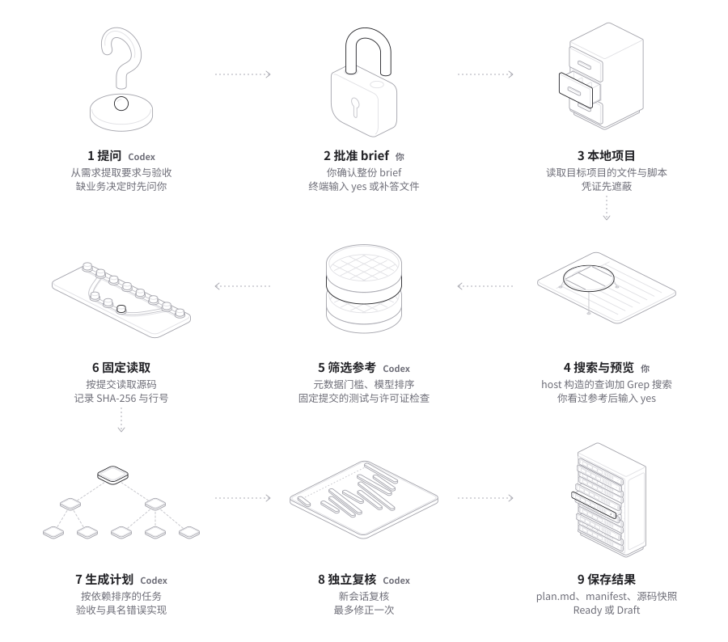

# 实现结构与参考

[English](architecture.md) · 简体中文

<picture>
  <source media="(prefers-color-scheme: dark)" srcset="images/how-it-works-dark.svg">
  
</picture>

## 处理步骤与模块

各步骤做什么见 README 的[工作原理](usage.zh-CN.md#工作原理)。下表列出每一步由哪些模块完成。所有 Codex 回合都经过 [app-server.ts](../src/app-server.ts)。

| 步骤 | 内容 | 主要模块 |
| --- | --- | --- |
| 1 提问 | 需求提取回合、业务问题、补答后的 brief 重建 | [workflow.ts](../src/workflow.ts)、[model-schema.ts](../src/model-schema.ts)、[cli.ts](../src/cli.ts) |
| 2 批准 brief | 终端输入 `yes`、通过 agent 协议回复 `approved: true`，或补答文件里的 `approveBrief: true`；记录 brief 的 SHA-256 | [brief-approval.ts](../src/brief-approval.ts)、[cli.ts](../src/cli.ts)、[storage.ts](../src/storage.ts) |
| 3 本地项目 | 有界文件列表、排除规则、凭证遮蔽、已有脚本 | [local.ts](../src/local.ts) |
| 4 搜索与预览 | 分档的 GitHub 查询、Grep 发现、批量元数据查询、GitLab 回退；搜索之后的步骤与参考预览，以及放行排序的终端或 agent 确认 | [preview.ts](../src/preview.ts)、[cli.ts](../src/cli.ts)、[github.ts](../src/github.ts)、[code-search.ts](../src/code-search.ts)、[repository-screening.ts](../src/repository-screening.ts) |
| 5 筛选参考 | 元数据门槛、模型排序回合、固定提交的文件树检查、模型选择回合 | [repository-screening.ts](../src/repository-screening.ts)、[github.ts](../src/github.ts)、[workflow.ts](../src/workflow.ts) |
| 6 固定读取 | 选文件回合、有界读取、哈希、行范围、摘录、补充请求回合 | [file-ranking.ts](../src/file-ranking.ts)、[evidence.ts](../src/evidence.ts)、[workflow.ts](../src/workflow.ts) |
| 7 生成计划 | 计划回合，host 校验 ID、引用、覆盖、依赖和具名错误实现 | [workflow.ts](../src/workflow.ts)、[model-schema.ts](../src/model-schema.ts) |
| 8 独立复核 | 新会话复核、一次修正、再复核、Ready 或 Draft 的判断 | [workflow.ts](../src/workflow.ts)、[model-schema.ts](../src/model-schema.ts) |
| 9 保存结果 | `plan.md`、`preview.html`、`stack.html`、两种 manifest、源码快照、补答文件的原子写入，每次运行的写入都经过同一个队列 | [report.ts](../src/report.ts)、[storage.ts](../src/storage.ts) |

流程图由 [images/how-it-works.mjs](images/how-it-works.mjs) 从 Hairline 的线条图生成，生成方法见 README 的[致谢](usage.zh-CN.md#流程图与致谢)。

## 数据流

```text
CLI / JSON / live agent caller
       |
       v
workflow: intake -> answers -> brief rebuild -> brief approval -> search -> preview gate -> tree screen -> selection -> evidence -> plan -> fresh review
    |                |          |                  |
    v                v          v                  v
Codex App Server   public APIs  snapshots        PlanDoc
auth / thread /    + local FS   + manifest          |
turn / interrupt                                  v
                                           Markdown / JSON
```

## 边界

| 文件 | 职责 |
| --- | --- |
| [cli.ts](../src/cli.ts) | 参数、终端及显式启用的实时 agent 澄清和批准、读取带已批准 brief 的补答文件、为 `needs_input` 和未批准的计划写出补答文件、ASCII 进度、JSON/JSONL 和退出码 |
| [agent-protocol.ts](../src/agent-protocol.ts) | 一个实时 JSONL stdin 读取器、host 请求 ID、严格的单待答请求校验、批量答案、brief 和预览决定、取消、固定失败信息和监听器清理 |
| [skill-install.ts](../src/skill-install.ts) | 内嵌 unshit agent skill（`src/resources/unshit-skill/SKILL.md`），写入 Claude Code 的 skills 目录和 Codex 的两个 skills 目录（`$CODEX_HOME/skills`、`~/.agents/skills`）；先写临时文件再改名；不覆盖非 unshit 安装的同名 skill（除非 `--force`）；`unshit` 文件夹或 `SKILL.md` 是符号链接时不跟随，skills 目录本身或更上层的符号链接照常跟随 |
| [workflow.ts](../src/workflow.ts) | 需求门槛、答复后的 brief 重建、brief 批准门槛、候选预排序、筛选与选择、读取、计划生成、参考测试缺口、独立复核与有界修正（含存活错误实现和待决事项）、超时结果与检查点 |
| [preview.ts](../src/preview.ts) | 运行步骤的顺序；预览记录器：登记 host 的记录（仓库、提交、文件、源码、摘录）并固定其类别，记录每一步用了哪些参考、怎么用；两版之间有变化的步骤；计划或复核引用的摘录 |
| [stack.ts](../src/stack.ts) | 计划从下往上的积木（先是数据模型的实体，再是模块），以及每块积木引用的 host 摘录，按仓库和固定提交分组；积木页面所用的 logo 积木画法 |
| [app-server.ts](../src/app-server.ts) | 原生双向 RPC、活动回合关联、最终文本、取消、空闲与总时长超时、失败原因和进程清理 |
| [github.ts](../src/github.ts) | host-built GitHub 查询、Grep 代码搜索、质量门槛、固定提交树验证与 GitLab 官方 API 回退 |
| [code-search.ts](../src/code-search.ts) | Grep 请求体、响应解析、按仓库聚合命中、批量 GitHub 元数据查询条件 |
| [local.ts](../src/local.ts) | 本地文件基线、排除规则、凭证值遮蔽与私钥文件排除、已存在脚本依据 |
| [repository-screening.ts](../src/repository-screening.ts) | 领域查询材料清理、查询计划、候选信号解析、整词候选排序、元数据与树质量判断 |
| [file-ranking.ts](../src/file-ranking.ts) | 需求词加权、测试与实现文件配额、文本路径和根许可证路径判断、许可证文件选择 |
| [evidence.ts](../src/evidence.ts) | 有界读取、共享文件排序、源码哈希、行范围、来源 ID 与固定链接 |
| [model-schema.ts](../src/model-schema.ts) | 每轮 JSON Schema、结构校验、来源归属（含参考测试摘录的角色）、完整覆盖、每个验证的具名错误实现、依赖无环和需求原话（`userWords`）校验，补答文件中已批准 brief 的重新校验，复核存活错误实现的读取（丢弃无法使用的项） |
| [brief-approval.ts](../src/brief-approval.ts) | brief 的可编辑形式及其 SHA-256、要求来源标签、终端批准前显示的 brief、只认 `yes` 的回复判断、推断要求的缺口与未批准说明 |
| [report.ts](../src/report.ts) | brief 批准记录、带来源标签的要求、设计、比较（每个采用模式的参考测试或没有测试的原因）、任务、验收、验证（含必须让它失败的错误实现）、复核中的存活错误实现、“Trusted, not checked”与源码对应表的 Markdown 输出 |
| [storage.ts](../src/storage.ts) | 原子保存报告、证据快照和可核对的补答请求上下文；未批准的 brief 以可编辑形式写入补答文件，`approveBrief` 为 false；两种 manifest 记录 `briefApproval` |
| [instructions.ts](../src/instructions.ts) | 内嵌技能入口、阶段模块与 host/model 职责约束，计算整个规则包的摘要 |

## 状态归属

Codex 管理认证与会话。CLI 在内存中关联 RPC 和当前回合；应用保存源码字节、哈希、有效行范围、计划及缺口。这些数据用于核对引用和保存中断前已有结果。

`needs_input` 的补答文件保存原问题与提示词、目录、规则版本的摘要。它解决非交互重跑时问题顺序或措辞变化的问题。重新运行后仍由需求门槛检查未解决的重大业务问题。

已回答的问题以 `resolvedAnswers` 传给候选选择、规划、复核及修正回合，并写入最终结果、报告、manifest 和中断检查点。报告将初始摘要与最终范围分别标注。

brief 定稿后，`approveBrief` 把本地扫描和参考检索挡在批准之后。终端批准记录 `via: "tty"`；显式启用的 `--agent` 回复记录 `via: "agent"`；`--answers` 可以提供已校验的批准 brief，记录 `via: "answers_file"`。`BriefApproval.briefSha256` 是不带 R*/A* ID 和来源标签的可编辑 brief 的哈希。`approvedAt` 来自终端或 agent 回复时的 host 时钟，或 CLI 读取补答文件的时间。记录写入结果、报告、两种 manifest 和检查点。缺少批准时只由 host 强制保持 Draft。计划和复核提示写明实际记录的方式，把这条就绪条件留给 host。终端、补答文件和 agent 协议都无法核实是谁批准。`verifiedUserWords` 只保留归一化后至少四个码位、出现在需求或已确认答案里的引文。agent 模式不修改 reference-plan 规则包，`REFERENCE_POLICY_HASH` 不变。

`--agent` 隐含 JSONL 输出并增加 JSONL stdin，使用同一个实时进程，不保存恢复状态。`agent-protocol.ts` 在整个运行期间监听，包括两次请求之间。每个 `input_request.requestId` 都是 host 新生成的 UUID，`kind` 为 `material_answers`、`brief_approval` 或 `preview_confirmation`。业务问题批次只按 brief 顺序包含未答问题；已有答案保留在最终答案上下文。brief 请求包含完整 brief。预览请求包含完整快照、版本和 CLI 刚刚等待发布完成的页面准确路径。只有 ID 匹配、恰好含所需非空答案或布尔值 `approved` 的 `input_response` 才能结束门槛等待。false 决定沿用既有 `needs_input` 停止行为。无效、提前、过期、重复、回复类型错误或含额外字段的回复，记录唯一的固定 `agent_protocol_error`，中断工作并以退出码 1 结束，不回显原始 stdin。完成前的 cancel、SIGINT 或 EOF 中断工作和待答请求，退出码 130。人的回复没有超时。`main` 输出唯一的最终结果，在 `finally` 关闭读取器并移除信号监听器；workflow 在 `finally` 关闭模型会话。

普通 JSON/JSONL 和非终端调用仍然没有终端提示，在缺少答案时或参考预览处停止。`--agent --json` 和 `--agent --install-skill` 无效，重复的 `--agent --jsonl` 可以使用。补答文件保持提示词、目录和规则摘要校验。已批准文件要求其 request 的所有问题都有答案，禁止可编辑 brief 含 `materialQuestions`，重新分配 ID 和来源后跳过需求提取、补答和重建，但不确认预览。brief 被拒或完成计划没有批准时，仍写出原有的可编辑补答文件。安装的 skill 保持一个 agent 进程运行，在聊天里展示问题批次和完整批准材料，只转达用户的明确决定；编辑或进程丢失时重新运行，无法使用可写实时 stdin 时改用可见终端，并读取返回的准确 `artifacts.reportPath`。

搜索返回之后，workflow 只用 host 的记录构建步骤与参考预览（`createPreviewRecorder`）：候选始终是搜索线索，固定提交文件树里的文件始终是“已列出、未读取”，只有 host 读取的源码或从中截取的摘录才是证据；模型返回的、不是 host 发出的 ID 不会显示。workflow 把每一版交给 `onPreview`，等它完成后才进入下一步；第一版页面写好之后调用一次 `confirmPreview`，只有返回 true 才放行候选排序，没有 `confirmPreview` 时返回带 `previewStop` 的 `needs_input`。CLI 里，预览页面、检查点和最终结果都经过每次运行的同一个队列（`createRunPublisher`）；页面只在队列写好源码快照之后才链接它；最终结果会关闭队列，把同一版（保存步骤已完成）写入 `plan.md`、`preview.html` 和 manifest。

复核回合的 outputSchema 除 `findings` 外还要求 `survivingMutants`，最多 12 项：复核者为某个 A* 构造、而所有计划检查仍会通过的错误实现，每项有 `acceptanceId`、`wrongImplementation`、`whyPlannedChecksPass` 和 `decisionNeeded`（字符串或 null）。`findings` 仍按原规则严格校验，有问题时复核失败；`survivingMutants` 只是建议，`parseReview` 不会因为它让复核失败：`acceptanceId` 不是 brief 中 A* ID 的项、不是对象或缺少字段的项、`wrongImplementation` 或 `whyPlannedChecksPass` 去掉首尾空白后为空或超过 1200 个字符的项、`decisionNeeded` 超过 700 个字符的项，以及第 12 项之后的项都被丢弃，整个字段不是列表时按没有处理。每次丢弃记为一条 `review` 类信息性缺口（`In review N, the host dropped ...`，字段不是列表时为 `In review N, the host read survivingMutants as none ...`），出现在报告的缺口列表和 manifest 的 `gaps` 里，不影响就绪状态。null 或空白的 `decisionNeeded` 记为没有决定；没有 `survivingMutants` 键的复核结果按没有错误实现处理。复核提示写明 `acceptanceId` 用 brief 的 A* ID，不用 T1-A1 这样的任务验收 ID，并给出 12 项上限；还要求复核者把 brief 和已确认答案没有定下的业务选择只作为带 `decisionNeeded` 的存活错误实现报告，不写成问题或修正建议。第一次复核中没有 `decisionNeeded` 的错误实现转成针对所属 R* 的重大问题，与其他重大问题一起进入唯一一次复核修正；最新一次复核仍报告的这类错误实现只留在该次复核的记录里，不影响就绪状态。有 `decisionNeeded` 的错误实现不进入修正回合；任何一次复核报告的，都成为一条 `Open decision for A* ("<验收标准原文>"): ...` 的 Draft 原因，按 brief 的批准方式写明做法：没有批准的运行修改它保存的补答文件（没有保存时先用相同命令重新运行，得到一份）；终端批准的运行重新运行，在批准提示处回复 yes 以外的内容，再修改保存下来的补答文件；agent 批准的运行按用户原话把决定加入需求，重新开始 `--agent` 运行并批准新的 brief 和预览；从已批准补答文件开始的运行修改同一个文件后再传入，说明写明这个文件的 `approveBrief` 已经是 true，重读并保存修改后的 brief 就是批准这次修改。修正通过 host 校验、但后续复核没有完成时，计划保持 Draft，Draft 原因写明没有完成的复核覆盖修正后的计划，第一次复核的重大问题和没有 `decisionNeeded` 的存活错误实现不再写成 Draft 原因（报告的复核记录里仍列出它们），任何一次复核的待决事项仍是 Draft 原因；修正本身没有通过校验时仍写 `The bounded review repair did not complete.`。复核提示要求：检查仍会通过的已命名错误实现也报告在 `survivingMutants` 中，`wrongImplementation` 以它的 ID 开头；与正确实现等价的已命名错误实现报告为重大问题。host 不核对 ID 前缀，也不判断等价。“Trusted, not checked”有一行写明存活错误实现和没有存活错误实现都只是复核模型的推理，unshit 没有应用或运行其中任何一个。review.md 加了同一规则，规则包摘要随之改变，旧的补答文件不再适用。

已有本地脚本与实施后要创建的命令分开记录。上游测试读取只支持参考判断；CLI 不把它们当作目标应用已执行的测试。

报告的“Checks performed”只写 host 实际做过的检查：读取并哈希源码、记录摘录行号、引用的摘录 ID 由 host 生成、参考比较只引用该仓库的固定提交、需求与验收覆盖、已有命令来自读过的本地文件、任务依赖存在且无环、每个验证为它覆盖的每条验收写出了错误实现、采用模式引用的参考测试来自 host 在该仓库固定提交读作测试的文件；它还写明 host 没有核对摘录是否支持旁边的说法，也没有运行目标项目的命令或测试。“Trusted, not checked”写 host 没有核对的部分，由 `report.ts` 的 `trustedLines` 生成。它的输入是 `plan.repositoryChoices` 中选中的仓库、`sources`（按提供方和仓库匹配，按 `roles` 数实现文件和测试文件）、`plan.tasks[].verification[].rejectsMutants`（错误实现个数）、`plan.referenceComparisons[].adoptedPatterns[].testEvidence`（不同参考测试摘录的个数）和 `briefApproval`（批准方式），这些都保存在 manifest 里。固定的四行写模型撰写的引用说法、按内容哈希标识的本地源码、同一模型的复核，以及存活错误实现只是复核模型的推理；错误实现个数、参考测试摘录个数和批准方式这三行，分别只在计划有错误实现、引用了参考测试和 brief 已获批准时出现。这一节本身不新增存储字段，也不改规则包；其他几项新增的字段和规则包变化见下文。

计划的每个验证方法带 `rejectsMutants`：对它覆盖的每条验收，至少一个错误实现（`wrongImplementation`）和检查在它上面报告的失败（`observedFailure`）。host 校验：条目只能指向这个验证覆盖的验收；覆盖的每条验收至少有一个条目；两段文字去掉首尾空白后为 1 到 500 个字符；人工检查和命令检查都需要。一个验证最多覆盖 24 条验收，`rejectsMutants` 也最多 24 项，所以每条验收写一个错误实现总放得下。编号由 host 按顺序生成，形如 `T1-V1-M1`，模型给的 ID 不采用。缺少或不合格时，走原有的一次计划修正，修正提示也写明每个覆盖的验收都要有条目。规划提示用 schema 和解析共用的常量（`MAX_VERIFICATION_ACCEPTANCES`、`MUTANT_TEXT_MAX`、`UNTESTED_REASON_MAX`）列出 host 会拒绝的上限，计划修正提示内含规划提示，也带这句。host 不判断错误实现是否真会让检查失败，也不应用或运行它们；报告里每个任务的 Done when 一句和“Trusted, not checked”一节写明这一点，“Checks performed”多了这项检查。plan.md 规则模块加了相应一段，规则包摘要随之改变，旧的补答文件需要重新生成。

参考比较里每个采用的模式带 `testEvidence` 或 `untestedReason`，恰好一个；`testEvidence` 最多 6 项，`untestedReason` 去掉首尾空白后为 1 到 700 个字符。文件挑选提示要求为选中的仓库同时挑选用到这些实现文件的测试。`testEvidence` 沿用证据归属校验：摘录必须来自这次比较的仓库和固定提交，而且来源的 `roles` 含 `test`。这个角色由 host 在读取时决定：模型选为测试的文件和 host 补选的测试文件都要满足 `isTestPath`，补充请求读入的文件也按 `isTestPath` 定角色。`isTestPath` 只看路径名，`app/tests.py`、`test_refund.py`、`Refunds.Tests/RefundTests.cs`、`refund_spec.rb` 这类布局不算测试；测试都放在这类路径下的参考仓库给不出测试摘录，计划总会带下面这条缺口，缺口文字和“Trusted, not checked”都写明 host 只按路径名认定测试文件。host 不判断引用的测试是否真的用到被采用的代码，这由独立复核判断；用不到的测试引用算作无依据的引用。没有任何采用模式引用参考测试时，host 由计划本身得出一条重大缺口（`repository` 类）：第一次复核前写进计划的 readinessNotes，复核和复核修正都能看到；修正后的计划重新计算，后续复核看到的是新结果；最终就绪状态按最终计划计算。这条缺口在最后一步才进入缺口列表，在那之前保存的检查点（包括复核中途被中断或超时时保存的）把当时计划的这条缺口加进检查点的缺口列表，缺口列表与计划的 readinessNotes 一致。没有参考比较时不加这条缺口，搜索或选择缺口已经让计划保持 Draft。“Checks performed”写明 host 核对了参考测试摘录的来源，“Trusted, not checked”写出引用的不同参考测试摘录个数（同一摘录引用多次只算一个）。research.md、plan.md、review.md 各加入一句规则，规则包摘要随之改变。

这几项改动新增的机器输出字段：`brief.requirements[]` 带 `origin`（`stated` 或 `inferred`），`stated` 时还带 `userWords`；`plan.tasks[].verification[]` 带 `rejectsMutants`；`plan.referenceComparisons[].adoptedPatterns[]` 带 `testEvidence`，没有测试引用时还带 `untestedReason`；`reviews[]` 带 `survivingMutants`。完成结果在有批准时带 `briefApproval`，写出补答文件时带 `answersFile`；批准被拒的 `needs_input` 结果带 `approvalRequested: true` 和 `resolvedAnswers`。两种 manifest 都有 `briefApproval`（没有时为 null），其余新字段随 `brief`、`plan` 和 `reviews` 保存。brief 定稿后写出的补答文件多了 `brief`（可编辑形式）和 `approveBrief`。进度事件多了 `brief_approval` 阶段，在终端或 agent 运行请求批准时出现；用已批准的补答文件运行时，`intake` 阶段报告 `skipped`。规则包摘要因 intake、research、plan、review 四个模块的改动而改变，此前生成的补答文件都会被拒绝。

每个 Codex 回合有两个时限。thread 上连续 10 分钟没有任何通知算空闲超时；session 就绪、回合请求发出之后，超过空闲时限的 3 倍算总时长超时。`--turn-timeout` 设置空闲时限。超时后 host 发送 `turn/interrupt`；即使 Codex 以 `interrupted` 结束该回合，结果仍是 `timed_out`，不当作用户取消，CLI 退出码为 124。brief 重建、候选排序、补充请求、计划修正和复核修正超时后走各自原有的失败处理；复核修正之后的那次复核超时后，计划保持 Draft，原因写明没有完成的复核覆盖修正后的计划。失败的回合会读取 `turn.error`，没有时读取该回合最后一条 `error` 通知，去掉链接和 token 后最多保留 300 个字符。Codex 拒绝 `turn/start` 请求时，错误消息保留 Codex 给出的原因，连接随后断开时也一样；去掉链接和 token 后，整条消息最多 240 个字符。Codex 进程退出后，读取端最多再等 1 秒，把 stdout 中已有的回应读完，之后才让未完成的请求失败。最多 500 条的滚动缓冲和原来一样收进所有线程的通知，供等待和工具检查使用；每个回合另外按回合 ID 保留本线程中回合结果要用的通知：`turn/completed`、每一级最终消息候选里最新的 `item/completed`（`final_answer` 阶段的 agentMessage、阶段为 null 的 agentMessage、plan）和最新的 `error` 通知；得知当前回合的 ID 之后只更新这个回合的，之前最多保留 500 个回合 ID 的。最终文本和失败原因都从保留的通知里取。连接断开时（包括进程退出后读完 stdout 中已有的回应），如果保留的通知里有当前回合的 `turn/completed`（回合 ID 来自 `turn/start` 的回应，或该回合的 `turn/started`、`item/started` 通知），回合结果取自这条通知；此前已记录的超时、取消、输入请求或被拦截的工具动作仍然优先。在 `turn/start` 得到回应之前，或回合开始后、到达时限之前连接断开，host 不再发送 `turn/interrupt`，也不等待新消息。等待回合结束的那一路在回合有了结果后随即停止，并清除它的计时器，所以没有收到 `turn/completed` 时，CLI 打印结果后也不会因这个计时器停留到空闲时限。

检查点按实际原因保存：`evidence`、`plan`、`interrupted`、`timed_out`、`failed`、`needs_input`。还没有计划时，占位计划的标题和说明对应这个原因；只有未通过 host 验证的计划才标为 `Draft plan blocked by validation`。

通过元数据门槛的候选多于 `GitHubResearcher.treeResolutionLimit` 时，workflow 先按 research 阶段的规则请模型排序，再按这个顺序检查文件树；排序失败、超时或返回未知 ID 时退回 host 排序，并记录非重大缺口。`research.trustworthyReferenceFound` 在读取源码之后计算。

公开仓库搜索由 host 使用 intake 的 `domainTerms` 和 `topicSlugs` 构建三档查询；模型不能直接编写 GitHub 查询语法。GitHub 与 GitLab 返回的星数、fork、归档、许可证、语言、topic 和日期信号写入研究摘要。host 先应用星数、推送日期、创建年龄、归档与 fork 门槛，再读取固定提交的树，确认存在测试文件；若搜索元数据没有可识别的 SPDX 许可证，包括 GitHub 无法识别时返回的 `NOASSERTION`，则要求树中有根目录许可证文件；同时有多个时优先标准文件名，`LICENSE-*` 只作备选，证据读取使用同一个文件。树检查通过后才交给模型选择，筛选原因和未发送查询也保存在 manifest 中。

GitHub 树响应上限为 8 MB，源码响应仍为 1 MB。文件树不再按字母顺序裁剪；GitHub 的 `treeTruncated` 使用提供方返回的截断标志。GitLab 树最多读取 25 页、每页 100 项；若 host 达到页数上限且仍有下一页，也会将该树标为截断。`file-ranking.ts` 被文件候选展示和自动证据挑选共享：它按 brief 与答复的领域词打分，并为测试、实现文件分别保留配额。

文件挑选回合最多挑 20 个文件。提示只列出每个已选仓库的来源、提交和日期，不附整棵文件树。可选文件按来源分组，每个文件只带 ID、路径、大小、角色提示和代码搜索命中。整份文件清单最多 300,000 个字符，本地项目和每个已选仓库平分额度，排名靠后的文件先被省略，省略的数量记为非重大缺口。模型返回未提供或重复的文件 ID 时，host 忽略这些 ID 并记录非重大缺口，运行继续。

证据摘录：所有摘录合计最多 260,000 个字符；每个文件分到剩余额度的平均份额，小文件用不完的额度留给后面的文件。全文放得进份额的文件整份摘录。其他文件先取开头 30 行（不足 30 行时取全部），份额不够时从末尾截短，连第一行都放不下时这个文件没有摘录。之后按得分从高到低处理得分大于 0 的行，得分相同时先处理靠前的行，已摘录范围内的行跳过。得分的算法本地与远程文件相同：行内每含一个需求词加 1 分（需求词是 brief 摘要与需求描述里前 30 个不同的词：以英文字母开头，由至少 4 个字母、数字、_ 或 - 组成，不分大小写）；每含一个 brief 的代码 pattern，如果这一行含 class、def、function、func、fn、interface、struct、type、enum、const、let 或 var 这些词就加 20 分，否则加 10 分。每个这样的行依次尝试三种窗口，取第一个放得下的：启发式找到的、包住这一行的定义（按行判断，最多 600 行；判断定义开头用的是另一份关键字清单）；这个定义超过 150 行时，取其中包含这一行的 150 行；最后是包含这一行的 60 行（文件不足 60 行时为整个文件）。这三种窗口不会被截短。遇到第一个三种窗口都放不下的行，这个文件的摘录就停止。

补充请求：首轮摘录最多用 220,000 个字符。首轮有摘录时，读完文件之后、写计划之前多一个回合：模型看过这些摘录，最多提出 8 项补充，每项是已读文件里某个名称的定义、已读文件的一段行范围，或未读文件清单里的文件（最多 6 个）；提示要求模型先要计划否则会列为缺少上下文的未读文件和定义。未读文件清单是文件挑选清单里还没读过的文件，最多 40,000 个字符，本地项目和每个已选仓库平分额度，排名靠后的先被省略。host 按顺序处理。定义：取第一个被识别为定义开头、且含这个名称的行（识别方式与上文找包住命中行的定义相同；名称前后不能紧接字母、数字、_ 或 $），没有这样的行就取第一个含这个名称的行，再依次尝试上述三种窗口。行范围：整段。未读文件：照首轮的方式读取，远程文件在固定提交读取；剩余额度按还要读的未读文件数平分，再按上述规则摘录。已摘录的行不再加入；放不下、找不到、读取失败、不在清单里或超过 6 个文件的项目跳过，记为非重大缺口。所有摘录合计仍不超过 260,000 个字符。这个回合失败或超时时，记一个非重大缺口，计划用首轮摘录。

代码搜索同样由 host 执行，模型线程的 MCP 仍全部关闭。host 向 `https://mcp.grep.app` 发送 JSON-RPC `tools/call`，调用 `searchGitHub`，请求不带任何凭证。该服务无会话，响应为 SSE；每次最多 10 条结果，链接指向分支而不是提交，也没有星数和日期。发现阶段最多搜 3 个 pattern，按命中的不同 pattern 数排序，忽略示例和文档路径，最多把 4 个新仓库合并为一次 `repo:` GitHub 搜索，再交给 `collectEntries` 的同一门槛。树验证通过后，每个仓库最多再搜 2 个发现阶段未命中的 pattern。`repo` 参数是部分匹配，所以 host 只保留仓库名完全一致、且路径存在于固定提交树的命中，写入 `RepositorySnapshot.codeMatches`。文件挑选和证据读取优先使用这些文件。摘录选取时，所有文件（包括本地文件）里含 brief 代码 pattern 的行都会加分，见上文的证据摘录。响应正文不是 `searchGitHub` 的结果时，这次失败记为 `invalid_response`，失败记录的 `responseProblem` 写明第一个没通过的检查：`not_json_rpc`（没有可读的 JSON-RPC 响应）、`rpc_error`（JSON-RPC error）、`tool_error`（`result.isError` 为 true）或 `no_hits`（结果里既没有命中，也没有无结果提示）。`not_json_rpc` 时，响应头的媒体类型符合 RFC 6838 才记入 `contentType`；`rpc_error` 时，错误码是整数才记入 `rpcErrorCode`。缺口信息带上同样的原因；响应正文里的文字不写入记录。查询记录写入 `research.codeSearch`，随 manifest 保存。代码搜索没有改动 `research.md`，规则包摘要不因它改变。

## 功能与固定源码依据

下表记录采用的原生协议行为。固定版本为 `openai/codex@322bbf4d8486efd7dbbcf49598711a9e3fefc282`，本机实际验证版本为 Codex 0.160.0。

| 功能 | 参考位置 | 本项目采用方式 |
| --- | --- | --- |
| 请求、响应、通知及 ID | [rpc.rs L1-L79](https://github.com/openai/codex/blob/322bbf4d8486efd7dbbcf49598711a9e3fefc282/codex-rs/app-server-protocol/src/rpc.rs#L1-L79) | 双向消息分类与请求关联 |
| 回合完成判定 | [turn.rs L30-L38](https://github.com/openai/codex/blob/322bbf4d8486efd7dbbcf49598711a9e3fefc282/codex-rs/app-server-protocol/src/protocol/v2/turn.rs#L30-L38) | completed、failed、interrupted 分开处理 |
| 每轮结构化输出 | [turn.rs L273-L276](https://github.com/openai/codex/blob/322bbf4d8486efd7dbbcf49598711a9e3fefc282/codex-rs/app-server-protocol/src/protocol/v2/turn.rs#L273-L276)、[跨轮测试 L107-L217](https://github.com/openai/codex/blob/322bbf4d8486efd7dbbcf49598711a9e3fefc282/codex-rs/app-server/tests/suite/v2/output_schema.rs#L107-L217) | 每个相关 turn 提交 schema，再进行 host 校验 |
| 可移植工作流规则 | [thread.rs L99-L106](https://github.com/openai/codex/blob/322bbf4d8486efd7dbbcf49598711a9e3fefc282/codex-rs/app-server-protocol/src/protocol/v2/thread.rs#L99-L106) | 技能入口与共同约束通过 developerInstructions 发送，详细模块随对应回合提供 |
| 原生取消 | [turn_interrupt.rs L98-L147](https://github.com/openai/codex/blob/322bbf4d8486efd7dbbcf49598711a9e3fefc282/codex-rs/app-server/tests/suite/v2/turn_interrupt.rs#L98-L147) | 匹配 turn/started 后 interrupt；无结束通知时有界清理 |
| 原生会话历史 | [thread.rs L1705-L1722](https://github.com/openai/codex/blob/322bbf4d8486efd7dbbcf49598711a9e3fefc282/codex-rs/app-server-protocol/src/protocol/v2/thread.rs#L1705-L1722) | 使用原生 thread，应用保留引用所需证据 |

配置取值以实际安装版本为准。[官方配置参考](https://learn.chatgpt.com/docs/config-file/config-reference)说明命令网络限制不会禁用 hosted search、MCP 或 apps；本次规划线程另外关闭这些工具，并保留用户模型与认证设置。

## 规则模块

规则入口为 [SKILL.md](../src/resources/reference-plan/SKILL.md)，完整文件随二进制内嵌，运行时不依赖用户技能目录。需求提取使用 intake；候选和文件选择使用 research；计划生成及修正使用 design 与 plan；独立复核使用 design、plan 与 review。

这些模块按阶段加入当前请求，不会全部放进初始 thread 指令。已经完成的回合仍由 Codex 原生会话历史保留。无需新增会话状态管理或加载服务。

规则包 SHA256 使用入口与五个模块的路径和字节计算；共同指令里的 host 约束和 unshit agent skill 不在其中。模块内容变化也会使旧补答请求的规则版本校验失败。具体摘要记录在运行的 manifest 中，实际打包与运行结果见[验证记录](verification.md)。
